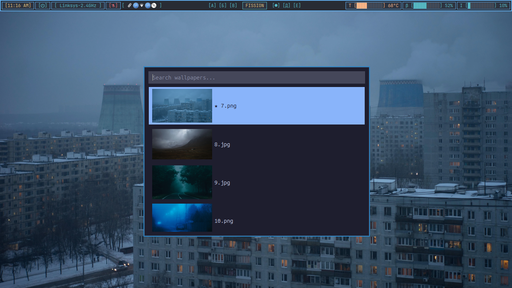
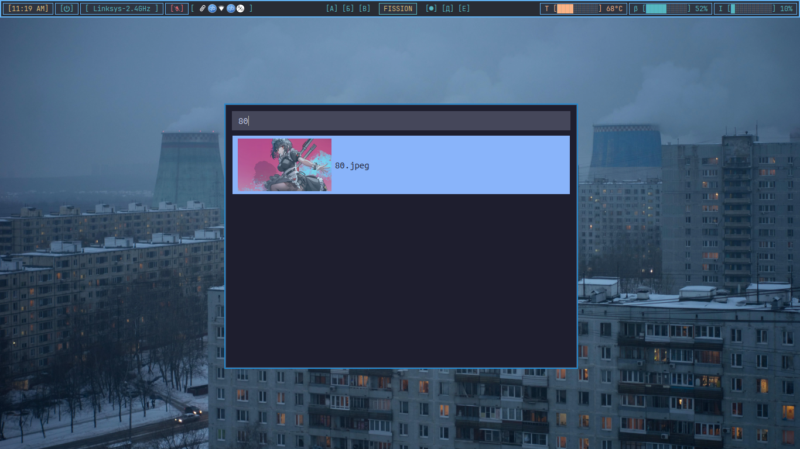

# i3x11wpl

**i3** (window manager) + **X11** (display server) + **W**allpaper **P**icker **L**auncher

A lightweight, keyboard-first wallpaper picker for i3 on X11. Opens as a small
floating window — like Rofi or dmenu — with a search box and a scrollable
list of your wallpapers. Pick one, it's applied instantly via `feh`, and the
picker stays open so you can keep browsing.

Not a full wallpaper manager. No slideshow, no multi-monitor config UI, no
bloat — just a fast overlay for switching wallpapers.

## Screenshots





## Features

- Frameless floating window, centered on screen, square corners
- Fuzzy-free substring search, focused and ready to type on open
- Full keyboard navigation: `↑`/`↓`, `Home`/`End`, `PgUp`/`PgDn`, `Enter`, `Esc`
- Applies wallpapers instantly with `feh --bg-fill`, no reopening needed
- Thumbnail cache — instant on repeat launches, background-generated on first run
- Currently-applied wallpaper marked with a ★
- Dark, flat theme matching Alacritty / Catppuccin Mocha colors
- Everything configurable via a plain-text config file

## Requirements

- Linux with i3 on X11
- Python 3.10+
- [`feh`](https://feh.finalrewind.org/) for setting the wallpaper

## Install

```bash
sudo apt install feh
git clone https://github.com/ishtiaque-f/i3x11wpl.git
cd i3x11wpl
./install.sh
```

`install.sh` creates a venv, installs Python dependencies into it, symlinks
`bin/i3x11wpl` into `~/.local/bin/i3x11wpl`, and installs a `.desktop` entry.
Make sure `~/.local/bin` is on your `PATH` (the installer warns you if it
isn't).

Drop your wallpapers into `~/Pictures/wallpapers` (`.png`, `.jpg`, `.jpeg`,
`.webp` supported), then run:

```bash
i3x11wpl
```

## i3 keybinding

Add to `~/.config/i3/config`:

```
bindsym $mod+w exec --no-startup-id i3x11wpl
```

Reload i3 (`$mod+Shift+r`), then `$mod+w` launches the picker.

## Usage

| Key            | Action                        |
|----------------|--------------------------------|
| Type           | Filter by filename             |
| `↑` / `↓`      | Move selection                 |
| `Home` / `End` | Jump to first / last            |
| `PgUp` / `PgDn`| Jump several rows               |
| `Enter`        | Apply the selected wallpaper    |
| `Esc`          | Close the picker                |

Applying a wallpaper does **not** close the picker — keep browsing and
switching until you find the one you want, then hit `Esc`.

## Configuration

Auto-created at `~/.config/i3x11wpl/config.ini` on first run:

```ini
[general]
wallpaper_dir = ~/Pictures/wallpapers
feh_command = feh --bg-fill

[window]
width = 600
height = 480
opacity = 0.97
border_radius = 0
font_family = Ubuntu Mono
font_size = 11

[thumbnail]
size = 48

[colors]
background = #1e1e2e
foreground = #cdd6f4
black = #45475a
blue = #89b4fa
green = #a6e3a1
red = #f38ba8
yellow = #f9e2af
magenta = #f5c2e7
cyan = #94e2d5
white = #bac2de
```

Edit and relaunch — no code changes needed. Thumbnails are cached in
`~/.cache/i3x11wpl/thumbnails` and only regenerated if a source image
changes.

## Uninstall

```bash
rm ~/.local/bin/i3x11wpl
rm ~/.local/share/applications/i3x11wpl.desktop
rm -rf ~/.config/i3x11wpl ~/.cache/i3x11wpl
rm -rf /path/to/i3x11wpl   # the cloned project folder
```

Also remove the `bindsym $mod+w ...` line from `~/.config/i3/config` if you
added it.

## Project structure

```
i3x11wpl/
├── main.py               # entry point
├── config.py              # loads ~/.config/i3x11wpl/config.ini
├── wallpaper_manager.py    # file scanning, thumbnail cache, feh integration
├── ui.py                   # PyQt6 window, list, search, keyboard handling
├── bin/i3x11wpl             # launcher script (the `i3x11wpl` command)
├── install.sh                # one-shot installer
├── i3x11wpl.desktop           # app launcher entry
└── requirements.txt
```

